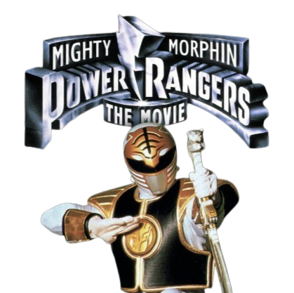
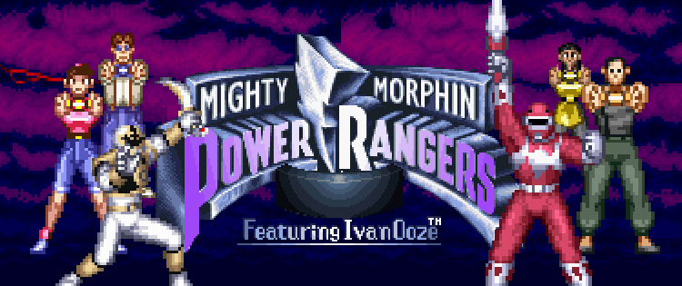
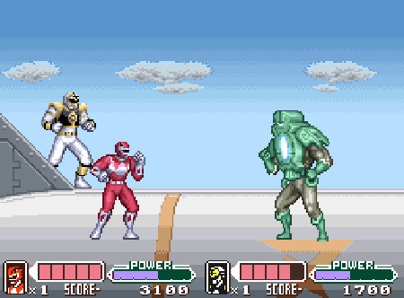
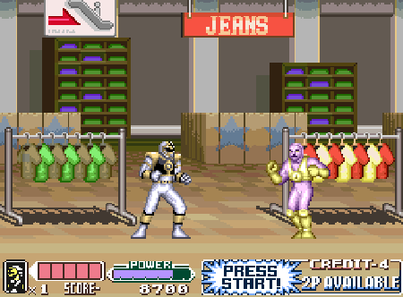
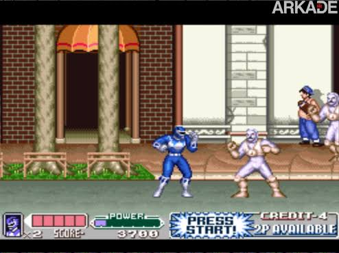
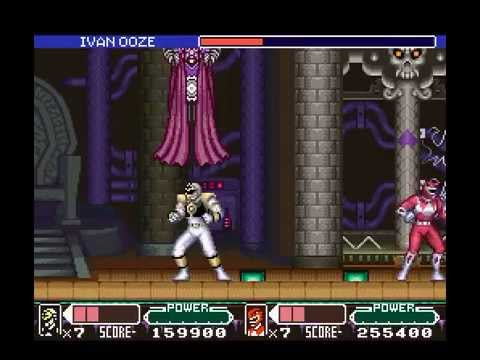
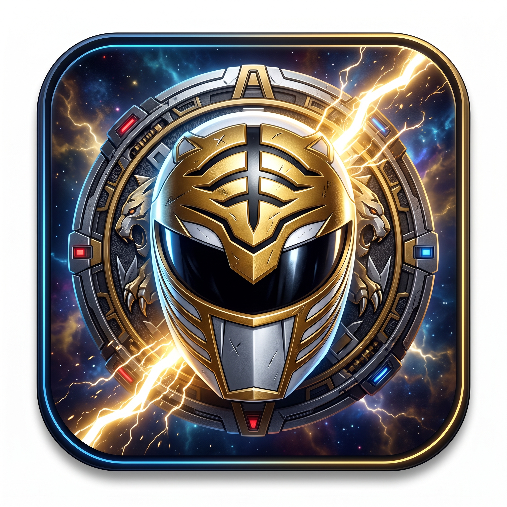

[Português (Brasil)](README.md) · **English**

<div align="center">



# ⚡ It's Morphin Time!

**Mighty Morphin Power Rangers: The Movie · PC Recomp**

The Super Nintendo classic reimagined as a native PC recompilation.<br>
Featuring save states, configurable gamepad controls, and Original/HD display modes on Windows.

<p>


</p>

**[⬇ Downloads](https://github.com/emanuelcnjunior/Mighty-Morphin-Power-Rangers---The-Movie-Recomp/releases)** · **[🎮 How to Play](#-how-to-play)** · **[📸 Gallery](#-gallery)** · **[⌨ Controls](#-controls)** · **[🛠 Build](#-for-developers)**

<a href="https://recomplauncher.com"><picture><source media="(prefers-color-scheme: dark)" srcset="https://recomplauncher.com/assets/press/launcher/badge-light.svg"></picture></a>

<br><br>

<br>
<sub>Project presentation art.</sub>

</div>

> **Bring Your Own ROM.** A compatible copy of the **SNES USA release** is required, without a copier header and without patches. File integrity is strictly verified by **SHA-256**. No ROM or extracted game textures accompany this distribution.

## 🎮 How to Play

### 1 · Download the Windows Release

Go to the **[Releases](https://github.com/emanuelcnjunior/Mighty-Morphin-Power-Rangers---The-Movie-Recomp/releases/latest)** page and download the portable Windows x64 ZIP package:

```text
Power-Rangers-The-Movie-PC-v0.2.1-Windows-x64.zip
```

The player package includes all required runtimes. **You do not need to install Python, Rust, CMake, or Visual Studio to play.**

### 2 · Select Your USA ROM

Extract the ZIP archive before opening the game. Double-click `Play.bat` (or `Launcher.exe`) to open the graphical configuration launcher. Select your USA SNES ROM file, configure your controller bindings, choose any desired cheat codes, and click **PLAY**. After validation, your preferences are saved for future sessions.

### 3 · Connect Your Gamepad and Jump into the Action

The game opens in fullscreen mode. Use the pre-boot launcher to customize your input mappings, and press **F10** in-game to adjust graphic filters and aspect ratio.

📖 **[Complete Windows distribution guide](installer/README.md)**

### Via RecompLauncher

The public distribution is provided as `Power-Rangers-The-Movie-PC-v0.2.1-Windows-x64.zip`. No standalone installer executable is required.

With RecompLauncher, you can select the ROM, verify it through the built-in importer, and start the game directly. It also exposes **volume, audio, and V-Sync** settings inside the launcher interface.

The package bundles `recomplauncher.json` beside the executable. In **Settings → Developers → Add a build**, select the ZIP to test Easy Setup locally.

🔗 **[Integration, validation and publication guide](docs/recomplauncher.md)**

## ✨ Key Features

| 💾 Save Your Progress | 🎨 Choose Presentation | 🎮 Play Your Way |
| :--- | :--- | :--- |
| Five manual save state slots | Seamless toggle between Original & HD | Built-in launcher with input configuration |
| Separate Quick Save / Quick Load | Nearest, Sharp and Scale2x filters | Full keyboard and gamepad shortcuts |
| In-game save-state browser | Borderless fullscreen & external HD packs | Access settings mid-game |

**About HD Mode:** Graphic filters work out of the box without texture packs. Custom redrawn textures are not included in the repository.

📖 **[Save states, graphics and HD packs guide](docs/save-and-graphics.md)**

## 📸 Gallery

<div align="center">
<table>
<tr>
<td width="50%" align="center"><br><sub>⚡ Rangers in combat</sub></td>
<td width="50%" align="center"><br><sub>🥊 Combat in Angel Grove</sub></td>
</tr>
<tr>
<td width="50%" align="center"><br><sub>🔵 Blue Ranger</sub></td>
<td width="50%" align="center"><br><sub>🟣 Final showdown with Ivan Ooze</sub></td>
</tr>
</table>

<sub>Reference screenshots provided for presentation. Third image retains the Arkade watermark present in the original source capture.</sub>
</div>

## ⌨ Controls

| Action | Keyboard | Controller¹ |
| :--- | :---: | :---: |
| Quick Save | **F1** | **L2** |
| Quick Load | **F2** | **R2** |
| Open Save State Browser | **F11** | **Share + R1** |
| Toggle Original / HD | **F6** | — |
| Open Graphic Settings | **F10** | — |
| Toggle Window / Fullscreen | **Alt + Enter** | — |
| Open Launcher during game | **Ctrl + L** | **Share + L3** |

¹ Controller button naming follows PlayStation convention. Use the launcher to customize your buttons.

> **Select shortcut investigation:** An optional Select tap shortcut was tested for HD toggle, but showed erratic behavior on DualShock 4 controllers. Use **F6** or **F10** while this gesture is being refined.

## ⚡ Cheats and Codes

The project includes a verified Game Genie and Pro Action Replay (PAR) cheat catalog for the USA release at [`config/power_rangers_the_movie_usa.cht`](config/power_rangers_the_movie_usa.cht):
- Infinite lives and continues
- Infinite health and invincibility
- Maximum special meter and test mode

Use [`tools/cheat_tool.py`](tools/cheat_tool.py) to decode codes into native memory addresses or detect conflicting cheat selections.

📖 **[Complete Cheats Guide and Catalog](docs/cheats.md)**

## 📁 Your Data, Your Progress

The Windows release keeps your personal data safely separated from the program binaries:

```text
%LOCALAPPDATA%\PowerRangersMovieRecomp\
├── config.ini      Settings & keybindings
├── saves\          Save states and Quick Save
├── hd-packs\       External texture packs
└── …               Imported ROM cache and local data
```

Updating or moving the extracted game folder does not overwrite or delete your progress.

## 🚧 Project Status

This project is **under active development**, with a working Windows x64 build and interactive validation through the title screen: video rendering, audio output, and controls are fully functional. End-to-end full campaign completion is still undergoing regression testing.

| Check | Status |
| :--- | :--- |
| ROM identity & SNES LoROM header | Verified |
| Windows x64 Release Build | Functional |
| Title screen boot & audio | Interactively verified |
| ROM verifier & importer | 12 automated test cases passed |
| RecompLauncher schema compliance | Validated against official specification |
| In-app RecompLauncher Easy Setup | Manual end-to-end test pending |
| End-to-end gameplay completion | Currently in verification |

Found a bug? **[Open an issue](https://github.com/emanuelcnjunior/Mighty-Morphin-Power-Rangers---The-Movie-Recomp/issues)** with your version, OS details, steps to reproduce, and logs. To generate a sanitized diagnostic bundle (logs only, no ROM or save data), run:

```powershell
python tools/run_diagnostic.py --rom "path/to/your_rom.sfc"
```

Never attach your commercial ROM file to issue reports.

## 🛠 For Developers

<details>
<summary><strong>🔍 Compatible ROM & Local Analysis</strong></summary>

<br>

ROM specifications are defined in [`rom_identity.txt`](rom_identity.txt):

| Property | Value |
| :--- | :--- |
| Edition | USA · Super Nintendo |
| Reference filename | `Mighty Morphin Power Rangers - The Movie (USA).sfc` |
| Size | 1,572,864 bytes · 12 Mbit |
| Mapping | LoROM (`$20`) |
| Reset vector | `$00:8000` |
| Battery SRAM | Not declared on USA cartridge |

**SHA-256 (bare image without copier header):**

```text
c706b70097c679f6f0ced6f77a30620807d0b2555fc3c683c0ec2fc791176039
```

To validate and inspect your local copy:

```powershell
python tools/rom_tool.py validate "rom/Mighty Morphin Power Rangers - The Movie (USA).sfc"
python tools/rom_tool.py inspect "rom/Mighty Morphin Power Rangers - The Movie (USA).sfc"
```

</details>

<details>
<summary><strong>⚙️ Generate and Build on Windows</strong></summary>

<br>

Requires Visual Studio 2022 with C++ x64, CMake 3.20+, Python 3.10+, and your legally owned ROM copy.

```powershell
git submodule update --init --recursive

& 'C:\Program Files\Git\bin\bash.exe' tools/regen.sh --rom `
  'C:/path/Mighty Morphin Power Rangers - The Movie (USA).sfc'

cmake -S . -B build -G "Visual Studio 17 2022" -A x64
cmake --build build --config Release --parallel 4
```

Code generated from the ROM under `src/gen/` is git-ignored and must remain local.

To run automated ROM-free test suites:

```powershell
python -m unittest discover -s tests -v
```

</details>

---

## 📜 Credits and Legal Notices

Project maintained by **[Emanuel](https://github.com/emanuelcnjunior)**, built on the **snesrecomp** and **recomp-ui** frameworks.

This is a non-profit fan project with no official affiliation with Saban, Bandai, Disney, Hasbro, or Nintendo. All trademarks, characters, and game assets belong to their respective copyright holders. Players must provide their own legally acquired copy of the game; no commercial ROMs, encryption keys, or extracted proprietary assets are distributed with this software.

<div align="center">
<br>

<br><br>
<sub>⚡ Back to Action!</sub>
</div>
