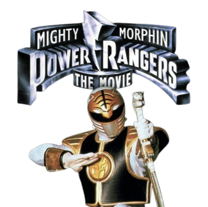
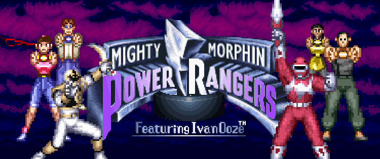
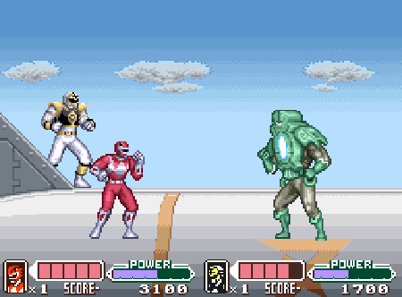
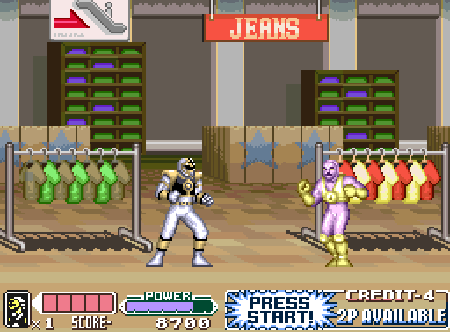
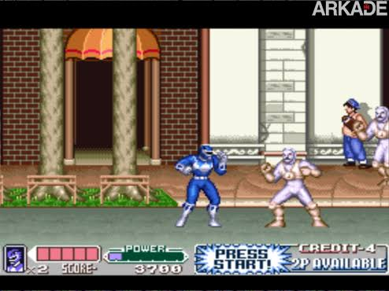
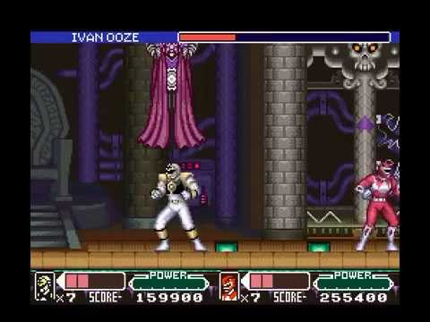

<div align="center">



# ⚡ It's Morphin Time!

**Mighty Morphin Power Rangers: The Movie · PC Recomp**

O clássico de Super Nintendo em um projeto de recompilação para PC.<br>
Save states, controles configuráveis e apresentação Original/HD no Windows.

<p>


</p>

**[⬇ Downloads](https://github.com/emanuelcnjunior/Mighty-Morphin-Power-Rangers---The-Movie-Recomp/releases)** · **[🎮 Como jogar](#-como-jogar)** · **[📸 Galeria](#-galeria)** · **[⌨ Controles](#-controles)** · **[🛠 Compilar](#-para-desenvolvedores)**

<a href="https://recomplauncher.com"><picture><source media="(prefers-color-scheme: dark)" srcset="https://recomplauncher.com/assets/press/launcher/badge-light.svg"></picture></a>

<br><br>

<br>
<sub>Arte de apresentação do projeto.</sub>

</div>

> **Traga sua própria ROM.** É necessária uma cópia compatível da edição **USA de SNES**, sem cabeçalho de copiador e sem patches. O conteúdo é verificado por **SHA-256**. Nenhuma ROM ou pacote de texturas extraído do jogo acompanha o programa.

## 🎮 Como jogar

### 1 · Baixe a edição Windows

Abra a página de **[Releases](https://github.com/emanuelcnjunior/Mighty-Morphin-Power-Rangers---The-Movie-Recomp/releases/latest)** e baixe o pacote portátil Windows x64:

```text
Power-Rangers-The-Movie-PC-v0.2.1-Windows-x64.zip
```

O pacote para jogadores inclui o runtime necessário. **Você não precisa instalar Python, Rust, CMake ou Visual Studio para jogar.**

### 2 · Selecione sua ROM USA

Extraia o ZIP antes de abrir o executável. Na primeira abertura, selecione o arquivo da sua ROM USA. Após a validação, o launcher abre e usa a cópia importada nas próximas execuções.

### 3 · Prepare seu controle e entre na ação

O jogo abre em tela cheia. Use o launcher para configurar os controles e **F10** para ajustar a apresentação durante a partida. Confira os atalhos abaixo para salvar e retomar seu progresso.

📖 **[Guia completo da distribuição Windows](installer/README.md)**

### Pelo RecompLauncher

A distribuição pública da v0.2.1 é exclusivamente
`Power-Rangers-The-Movie-PC-v0.2.1-Windows-x64.zip`. Instaladores `.exe` não
são gerados nem publicados pelo fluxo normal.

A integração adicionada ao repositório permite selecionar a ROM, verificá-la com o importador existente e iniciar diretamente o jogo. Também expõe **volume, áudio e V-Sync** no launcher.

O empacotamento gera o ZIP com `recomplauncher.json` ao lado do executável. Em
**Settings → Developers → Add a build**, selecione o ZIP e valide Easy Setup
localmente.

> A integração ainda precisa de validação de ponta a ponta dentro do aplicativo RecompLauncher antes de ser anunciada como testada.

🔗 **[Integração, validação e publicação](docs/recomplauncher.md)**

## ✨ Recursos do projeto

| 💾 Salve sua jornada | 🎨 Escolha a apresentação | 🎮 Jogue do seu jeito |
| :--- | :--- | :--- |
| Cinco slots manuais de save state | Alternância entre Original e HD | Launcher com configuração de controles |
| Quick Save separado dos slots | Filtros Nearest, Sharp e Scale2x | Atalhos de teclado e gamepad |
| Navegador de saves durante o jogo | Tela cheia e pacotes de texturas externos | Acesso ao launcher durante a partida |

**Sobre o modo HD:** os filtros funcionam sem um pacote de texturas. Arte redesenhada do jogo não está incluída.

📖 **[Save states, gráficos e pacotes HD](docs/save-and-graphics.md)**

## 📸 Galeria

<div align="center">
<table>
<tr>
<td width="50%" align="center"><br><sub>⚡ Rangers em ação</sub></td>
<td width="50%" align="center"><br><sub>🥊 Combate em Angel Grove</sub></td>
</tr>
<tr>
<td width="50%" align="center"><br><sub>🔵 Ranger Azul</sub></td>
<td width="50%" align="center"><br><sub>🟣 Confronto com Ivan Ooze</sub></td>
</tr>
</table>

<sub>Imagens de referência do jogo fornecidas para a galeria. Não representam uma validação dessas cenas no recomp. A terceira imagem mantém a marca Arkade presente no arquivo original.</sub>
</div>

## ⌨ Controles

| Ação | Teclado | Controle¹ |
| :--- | :---: | :---: |
| Salvar rápido | **F1** | **L2** |
| Carregar save rápido | **F2** | **R2** |
| Abrir navegador de saves | **F11** | **Share + R1** |
| Alternar Original / HD | **F6** | — |
| Abrir configurações gráficas | **F10** | — |
| Alternar janela / tela cheia | **Alt + Enter** | — |
| Abrir launcher durante o jogo | **Ctrl + L** | **Share + L3** |

¹ Nomes na convenção PlayStation. Consulte o launcher para configurar suas entradas.

> **Atalho Select em investigação:** foi implementado um toque em Select para alternar HD, mas houve relato de falha com DualShock 4. Use **F6** ou **F10** enquanto esse comportamento é investigado.

## 📁 Seus dados, seu progresso

A edição Windows mantém os dados pessoais separados dos arquivos do programa:

```text
%LOCALAPPDATA%\PowerRangersMovieRecomp\
├── config.ini      Configurações
├── saves\          Save states e Quick Save
├── hd-packs\       Pacotes de texturas externos
└── …               ROM importada e demais dados locais
```

O RecompLauncher mantém a ROM importada, as configurações e os saves na pasta de dados do usuário. Atualizar ou remover a pasta extraída não altera esses dados. O perfil de backup aponta para `saves`, sem incluir a ROM.

## 🚧 Estado do projeto

Projeto **em desenvolvimento**, com build Windows x64 e validação interativa até a tela de título: vídeo, áudio e teclado funcionaram nos testes registrados. A correção do jogo inteiro ainda não foi estabelecida.

| Verificação | Situação |
| :--- | :--- |
| Identidade da ROM e cabeçalho SNES | Validados |
| Build Windows x64 Release | Concluído |
| Boot até a tela de título | Validado interativamente |
| Verificador e importador de ROM | 12 casos de teste aprovados |
| Perfil RecompLauncher | Validado contra o schema oficial |
| Easy Setup dentro do aplicativo RecompLauncher | Validação manual pendente |
| Compatibilidade do início ao fim do jogo | Ainda não estabelecida |

Encontrou um problema? **[Abra uma issue](https://github.com/emanuelcnjunior/Mighty-Morphin-Power-Rangers---The-Movie-Recomp/issues)** com a versão, seu sistema, passos para reproduzir e relatórios disponíveis. Não anexe sua ROM.

## 🛠 Para desenvolvedores

<details>
<summary><strong>🔍 ROM compatível e análise local</strong></summary>

<br>

A identidade central está em [`rom_identity.txt`](rom_identity.txt).

| Propriedade | Valor |
| :--- | :--- |
| Edição | USA · Super Nintendo |
| Nome de referência | `Mighty Morphin Power Rangers - The Movie (USA).sfc` |
| Tamanho | 1.572.864 bytes · 12 Mbit |
| Mapeamento | LoROM (`$20`) |
| Vetor de reset | `$00:8000` |
| SRAM de bateria | Não declarada pelo cartucho USA |

**SHA-256 da imagem sem cabeçalho:**

```text
c706b70097c679f6f0ced6f77a30620807d0b2555fc3c683c0ec2fc791176039
```

Para análise, coloque sua ROM local em `rom/` e execute:

```powershell
powershell -ExecutionPolicy Bypass -File .\tools\analyze-rom.ps1
```

O script recusa hashes inesperados. `-AllowUnknownHash` destina-se apenas à investigação deliberada de outro dump.

</details>

<details>
<summary><strong>⚙️ Gerar e compilar no Windows</strong></summary>

<br>

Requer o ambiente de desenvolvimento do projeto, Visual Studio 2022 com C++ x64, CMake e sua própria ROM compatível.

```powershell
git submodule update --init --recursive

& 'C:\Program Files\Git\bin\bash.exe' tools/regen.sh --rom `
  'C:/caminho/Mighty Morphin Power Rangers - The Movie (USA).sfc'

cmake -S . -B build -G 'Visual Studio 17 2022' -A x64
cmake --build build --config Release --parallel 4
```

O código derivado da ROM em `src/gen/` é ignorado pelo Git e deve permanecer local.

Para gerar exclusivamente o ZIP portátil Windows x64 e seus hashes:

```powershell
powershell -ExecutionPolicy Bypass -File installer/build.ps1
```

Esse fluxo não requer Inno Setup. Os scripts antigos do Inno Setup permanecem apenas para manutenção histórica e não fazem parte da distribuição pública. `scripts/package_release.sh` mantém um fluxo separado de desenvolvimento para antigos setup packs que recompilam localmente.

📖 [Empacotamento Windows](installer/README.md) · [Checklist de publicação RecompLauncher](docs/recomplauncher.md)

</details>

<details>
<summary><strong>🧩 Componentes e próximos passos</strong></summary>

<br>

- **SNESRecomp:** toolchain e runtime usados pelo projeto.
- **[recomp-ui](https://github.com/emanuelcnjunior/recomp-ui):** launcher, seleção e verificação de ROM, controles e configurações. A referência de integração é a branch `tmnt4-save-hotkeys`.
- **SDL3:** integração desktop para janela, áudio e controles.

A análise nativa inicial gerou 24 variantes AOT exatas a partir de quatro raízes no banco `$00`, com 70 arestas de fluxo de controle. Esse resultado inicial não comprova compatibilidade do jogo inteiro.

Os próximos passos incluem ampliar a validação determinística, investigar o atalho Select no DS4, testar Easy Setup dentro do RecompLauncher e melhorar a distribuição para outras plataformas. Modo portátil, importação de ROM em ZIP e conquistas estão entre as melhorias documentadas.

</details>

## 🤝 Créditos e licença

Projeto mantido por **[Emanuel](https://github.com/emanuelcnjunior)**, com base no SNESRecomp e no `recomp-ui`. Consulte a [licença do projeto](LICENSE) e as licenças dos componentes para os termos aplicáveis.

Projeto de fãs, sem afiliação oficial aos detentores de Power Rangers. As marcas e o jogo original pertencem aos seus respectivos titulares. O jogador deve fornecer sua própria cópia compatível; ROMs, chaves e assets extraídos do jogo não são distribuídos com o programa.

<div align="center">
<br>


**Go Go Power Rangers! ⚡**

[Downloads](https://github.com/emanuelcnjunior/Mighty-Morphin-Power-Rangers---The-Movie-Recomp/releases) · [Reportar problema](https://github.com/emanuelcnjunior/Mighty-Morphin-Power-Rangers---The-Movie-Recomp/issues) · [Código-fonte](https://github.com/emanuelcnjunior/Mighty-Morphin-Power-Rangers---The-Movie-Recomp)

</div>
